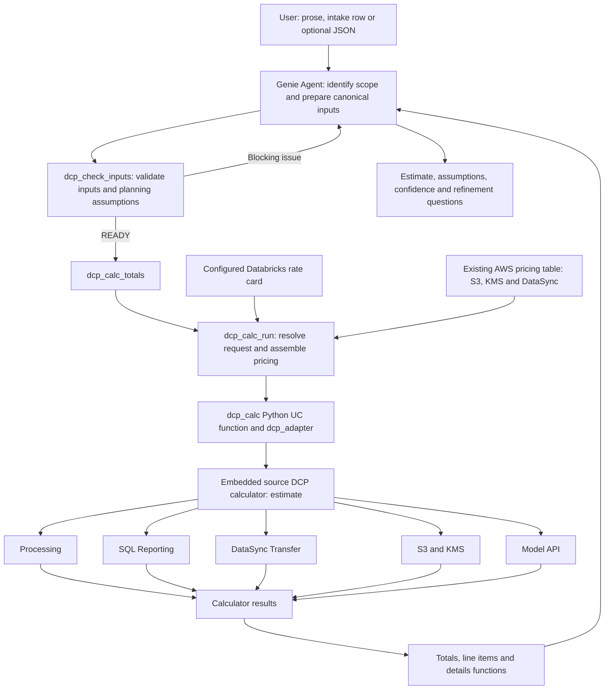

# DCP Genie Cost Estimator: demo guide

Audience: business stakeholders, workload owners and technical teams. Suggested duration: 7–10 minutes. Use **Agent Mode** in the fevm validation agent. Start a fresh conversation for unrelated workloads. This demo is DCP-only; Lakemeter routing is not included.

## 1. Opening: what the estimator does (45 seconds)

> “The DCP Genie Cost Estimator turns a workload description or pasted intake row into a planning cost estimate. Users describe what they want to run; they do not need to learn the calculator’s JSON schema. Genie identifies the supported calculation areas, prepares the inputs, validates them and calls our DCP calculator. The response shows a cost range, assumptions, confidence, monthly and one-time costs, and questions that improve accuracy.”

| Calculation engine | Supported workload examples | Typical inputs |
|---|---|---|
| Processing | Scheduled batch, event-driven batch, continuous streaming, ML training, batch scoring | Workload type, runtime, frequency, compute constraints |
| SQL Reporting | Reporting and dashboards | Concurrent users, working days, usage assumptions |
| DataSync Transfer | Recurring AWS DataSync transfers and initial migration | Daily GB, transfer days, initial migration GB |
| S3 and KMS | Retained S3 data, object requests and encryption | TB retained, files/day, reads/writes, encrypted files, keys |
| Model API | Recurring model/token usage and one-time token jobs | Supported model, calls/day, input/output tokens, initial job totals |

Five engines have six request sections: recurring model endpoints and one-time model jobs both belong to Model API. A supported engine does not guarantee that every product choice has a usable configured rate; missing rates remain pending.

## 2. Guided conversation: first estimate, then refinement (2 minutes)

Begin with:

```text
I need a DCP cost estimate. What workload information should I provide?
```

Explain that Genie should help identify the calculation area. A completely vague request cannot yield a meaningful dollar figure. Business choices are clarified; defaultable usage quantities do not require an approval round.

Continue with:

```text
I am planning a scheduled batch workload running 30 times per month.
Runtime is not known yet. The remaining cost areas are not applicable.
```

Point out the first estimate and LOW/EXPECTED/HIGH scenarios. The documented batch runtime baseline is 1/2/3 hours; default compute assumptions are also disclosed. Missing IDs/names are generated. Defaulted cost quantities mean LOW confidence. The user did not write JSON.

Refine in the same conversation:

```text
We measured runtime at 0.5 hours LOW, 1 hour EXPECTED and 2 hours HIGH
per run. Keep 30 runs per month. Recalculate and show the assumptions
that still affect confidence.
```

Explain that measured values replace the relevant defaults, while remaining defaults are still disclosed. Do not promise HIGH confidence just because one quantity was measured.

> “The conversation gives a useful starting point and improves it as information arrives. An unanswered scope question is shown as unpriced, not silently treated as zero. Invalid supplied numbers and unsupported selections are not replaced with invented facts.”

## 3. Route one plain-language workload through all five engines (3 minutes)

Paste this as a **new conversation**, without JSON:

```text
Give a first DCP cost estimate in US East for this workload, with
LOW/EXPECTED/HIGH totals and a breakdown by engine. I do not have
calculator JSON.

Processing: scheduled batch, 30 runs/month, runtime LOW 1 hour,
EXPECTED 2 hours, HIGH 3 hours per run.

SQL reporting: 10 concurrent users, 22 working days/month.

AWS DataSync: 3 GB/day on 22 days/month, plus an initial one-time
migration of 1200 GB.

S3 and KMS: 5 TB retained, 400 files/day of which 20 are encrypted,
one KMS key, 30 days/month, one write and two reads per file,
one KMS request per encrypted file.

Model API: gpt-5.4-nano, 100 calls/day, 1000 input tokens and
200 output tokens per call in every scenario, 30 days/month.
No one-time model jobs.

Use documented planning defaults for other supported quantities,
generate IDs/names, and disclose assumptions and pending prices.
Separate monthly and one-time costs.
```

Show these proof points in the actual response:

1. All five areas were recognized from ordinary workload facts.
2. Genie prepared the calculator input; the user did not author the schema.
3. Monthly totals and one-time migration are separate.
4. The engine breakdown identifies processing, SQL, transfer, storage/KMS and models. S3 and KMS can have separate technical line-item labels while remaining one functional engine.
5. Defaults, confidence and rate status are visible. An unavailable rate remains pending.

If necessary, follow up:

```text
Show the existing estimate broken down by engine, including the
quantities, rates, pricing status, formulas and pending items.
```

Use `dcp_calc_line_items` tool output to substantiate routing. Do not rely solely on the agent listing engine names in prose. Dollar figures depend on the deployed pricing configuration; show live results rather than memorized amounts.

## 4. How Genie connects to the calculator (90 seconds)



> “Genie handles the conversation and maps supported facts into calculator inputs. The adapter validates and constructs the request, applies audited planning defaults, creates the pricing provider and shapes the results. The DCP Python calculator performs the cost computation. Genie explains returned figures rather than inventing arithmetic or rates.”

Phase 1 embeds the source calculator in a Python Unity Catalog function during setup. It does **not** call the local laptop script or the separate Phase 2 wheel prototype at runtime. SQL functions are the callable interface. The generated setup notebook embeds `CALC_SQL` and `ENGINE_INPUTS_SQL`; these install the execution functions and input-reference metadata.

Implementation references:

- `notebooks/dcp_estimator.py`: source calculator and five engines.
- `calculator/dcp_adapter.py`: input checks, defaults, reference scenarios, pricing provider and calculator invocation.
- `calculator/build_sql.py` / `sql/06_dcp_calculator.sql`: generated UC interface and embedded Python runtime.
- `sql/12_dcp_engine_inputs.sql`: input-reference metadata.
- `genie/instructions.md`: conversational behavior and presentation.
- `setup_genie_dcp_agent.py`: generated self-contained installer.

## 5. Optional RAG planning example (1 minute)

```text
We are planning a RAG assistant with indexing and user-query activity.
We expect 990 total Model API calls per day. Models and token usage
are TBD. Give a conditional first planning estimate, disclose the
reference model and token assumptions, and keep initial document
indexing separate from recurring activity.
```

The restored RAG_REFERENCE_V1 profile uses assumed Nano/GTE/GPT/Claude roles at source weights 330:300:215:132, normalized to the supplied daily total. Recurring query embeddings/enrichment remain distinct from initial full-corpus indexing. At the verified fevm reference rate, the 990-call scenario returned monthly LOW/EXPECTED/HIGH $106.08/$481.93/$857.78 plus initial indexing $509.29/$530.54/$551.79. These are conditional reference-scenario results, not a universal price for 990 queries or a production forecast. Confidence is LOW. Retrieval/vector search itself is unpriced.

## Presenter checks and boundaries

- Open the intended fevm validation agent and select Agent Mode before presenting.
- Check warehouse access and configured rates; fevm reference list prices may differ from production account pricing.
- A model workload is priced only through supported registry conversions; not every model or compute choice is covered.
- State which quantities vary across LOW/EXPECTED/HIGH; the scenarios do not automatically include demand growth, retries or every production overhead.
- The latest recorded baseline is 66 passing local tests plus targeted live RAG checks. This is not a claim that every conversational variation has passed.
- If the agent asks for a genuine ambiguity, demonstrate the follow-up naturally. Never present expected behavior or prepared examples as a successful live execution.

## Verified five-engine rehearsal — November 18, 2026

The exact plain-language prompt in section 3 was executed in fevm Agent Mode.
The agent validated and calculated the same canonical JSON; all five request
areas were present, and direct calculator line items contained AWS_STORAGE,
DATA_PROCESSING, DATA_TRANSFER, MODEL_API and SQL_REPORTING. Displayed monthly
amounts matched direct calculator results. No agent configuration was changed.

| Scenario | Recurring monthly | One-time migration |
|---|---:|---:|
| LOW | $89.78 | $4.74 |
| EXPECTED | $127.48 | $4.74 |
| HIGH | $286.18 | $4.74 |

EXPECTED recurring breakdown: processing $27.00; SQL $48.40; DataSync $0.26;
S3/KMS $50.47; Model API $1.35. Confidence LOW; no pending line items in this
rehearsal. These values depend on fevm's configured reference/billed rates.

[Open the verified demo conversation](https://fevm-classic-stable-naren.cloud.databricks.com/genie/rooms/01f1dec23c071fe68b29cab8c42f3fe8/chats/01f1e386d5de16729cf0c60e37224a02)

Local evidence (Git-ignored):
`benchmark/results/demo-five-engines-20261118T193244Z/` contains the prompt,
Agent Mode response, prepared request in tool calls, direct results and summary.
The raw response also surfaced a wide totals table alongside its concise
summary. For presentation, focus on the summary and engine breakdown, or ask
for a concise stakeholder view. Do not claim all output formatting is fixed.
