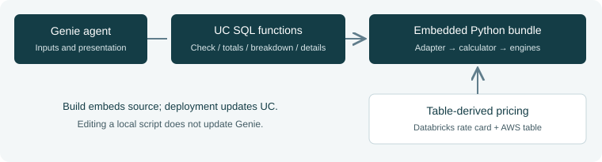

# DCP Estimator & Genie
## Source maintenance and extension guide

**Team reference • 5 November 2026 • Current DCP-only implementation**

Maintain one calculator source, deploy its embedded Python bundle as Unity Catalog (UC) functions, and let Genie collect inputs and present those functions’ results.

### 1. Understand what runs where



| Asset | Responsibility |
|---|---|
| `notebooks/dcp_estimator.py` | Request models, validation, compute selection, five engine calculations, totals and confidence. |
| `calculator/dcp_adapter.py` | Genie-oriented input and scope checks, request building, pricing-provider creation and result shaping. |
| `calculator/aws_rate_lookup.py` | Select AWS table rates, billed/list basis, exact units and confirmed conversions. Its bundled module name is `aws_pricing`. |
| `calculator/bundle_manifest.json` | Ordered Python files embedded in UC functions. |
| `calculator/build_sql.py` | Generates UC function definitions and embeds the Python bundle. |
| `genie/` | Instructions, function registrations, examples, input-table metadata and live snapshots. |

**There is no Python file uploaded “inside” Genie.** The build embeds the full calculator source and supporting modules in UC functions. `dcp_calc` runs calculations; `dcp_check` runs input validation. Genie calls SQL wrappers over those functions.

**The repository file and deployed copy are separate.** Saving a source edit or pushing to GitHub does not update the deployed functions. Rebuild and deploy after testing.

**Current maintenance baseline:** AWS pricing comes from an existing configured table. Source period dates are audit-only; they do not filter AWS prices. BILLED is the default, LIST is explicit. The exact DataSync charge “Data copied (per GB)” has a user-confirmed per-GB interpretation. Databricks date filtering remains separate.

<div class="page-break"></div>

## 2. Upgrade to a new calculator version

Create a working branch, retain the current deployed version, and compare the new script with `notebooks/dcp_estimator.py` before replacing it. Review **inputs, entry points, outputs, capabilities and dependencies**.

| What changed? | What must be reviewed or updated? |
|---|---|
| Formulas only; same interface | Calculator source and tests with independently checked expected values. |
| Input dataclass fields, defaults or enum values | Adapter validation and intake; `dcp_request` SQL arguments/building; engine input-reference generation. |
| `estimate()` or pricing-provider interface | Adapter calls, request construction and rate-provider construction. |
| New engine or workload | Core orchestration, request model, validation, adapter sections/area states, input-reference metadata and Genie category guidance. |
| Totals, line items or result shape | Adapter `shape()` and SQL schemas/projections in `build_sql.py`. Check `RESULT`, `TOTALS`, `LINES` and detail projections. |
| New billing unit, SKU or AWS service | AWS mapping/SQL helper, rate assembly and conversions; Databricks rate refresh mappings where applicable. |
| New Python file or package | Bundle manifest/dependency order; deployment environment compatibility for external packages. |
| New public UC function | Function DDL, repository registration, permissions, verified example and routing guidance. |

### Review these specific contracts

1. **Inputs:** names, types, required/conditional fields, defaults, allowed values and identifiers.
2. **Entry points:** `estimate()`, request deserialization, preset loading and pricing methods.
3. **Outputs:** `to_dict()`, scenario keys, pending treatment, engine labels, totals, confidence and warnings.
4. **Capabilities:** engines, workload categories, scenarios, regions and pricing units.
5. **Dependencies:** helper modules, import-time behavior, external packages and Spark requirements.

### Rebuild locally

Run from the actual estimator repository root:

```bash
python3 calculator/build_all.py
python3 -m unittest discover -s tests -q
git diff --check
```

The build runs AWS SQL generation, calculator SQL generation, engine input generation, rate-refresh notebook generation and setup-notebook generation in dependency order.

**Edit source files and generators.** `sql/06_dcp_calculator.sql`, `sql/12_dcp_engine_inputs.sql`, `sql/14_aws_pricing.sql` and `setup_genie_dcp_agent.py` are generated artifacts. Include rebuilt artifacts in the release; do not hand-edit them as the permanent fix.

**Passing the build is not full integration evidence.** Dataclass fields may appear in metadata automatically, but conditional validation, scope handling and SQL argument support still require review.

<div class="page-break"></div>

## 3. Add a module to the calculator bundle

Choose this route when the new logic contributes to DCP totals, breakdowns or confidence, or is a helper used by the calculator. A helper does not need its own Genie function registration.

### Example: add a calculator helper

Create `calculator/new_engine.py`. If `dcp_estimator.py` imports it, load it first:

```json
{
  "modules": [
    {"name": "new_engine", "path": "calculator/new_engine.py"},
    {"name": "dcp_estimator", "path": "notebooks/dcp_estimator.py"},
    {"name": "aws_pricing", "path": "calculator/aws_rate_lookup.py"},
    {"name": "dcp_adapter", "path": "calculator/dcp_adapter.py"}
  ]
}
```

If only the adapter imports the helper, place it before the adapter. **The adapter must remain last.** Names are flat import names, not dotted package paths. The file must be inside the repository.

### Wire a new engine end to end

1. Add its input model and parsing in the calculator request model.
2. Add type/range/conditional validation and define pending behavior.
3. Call the engine from `estimate()`; produce the established line-item structure.
4. Classify recurring versus one-time costs and include each line once in totals.
5. Extend the adapter’s `SECTIONS`, area/scope handling, missing-input questions and result handling as needed.
6. Extend the SQL request builder and the input-reference generator’s engine names, units, examples and conditions.
7. Update Genie discovery guidance and examples if users can select the new area.
8. Test the engine in isolation and through the generated bundle, then deploy.

**Adding a manifest entry only packages code.** It does not call a new engine, add a request area, register a Genie tool or include new costs in totals.

### Bundle constraints

The current loader rejects source containing three consecutive single quotes or `$$`, and source ending with a backslash. Use triple-double-quoted docstrings where needed. Dependencies must load before importers. The bundle hashes source and manifest content to change the Python worker cache key when code changes.

Adding a file to the manifest does not install third-party packages. Confirm supported dependencies in the UC Python function environment. Spark-dependent code must remain outside the pure calculator execution path unless the runtime explicitly supports it.

<div class="page-break"></div>

## 4. Add a separate capability directly to Genie

Choose this route for an independent capability that does not need to be part of DCP totals. **You cannot attach a `.py` script to Genie as an executable module.** Expose callable logic as a UC SQL or Python function, then register that function with the agent.

### Example: a separate DCP sizing helper

The following is illustrative SQL, not a deployed function or an AWS pricing formula. Its direct numeric inputs make it independently testable and avoid introducing arbitrary rates.

```sql
CREATE OR REPLACE FUNCTION
  your_catalog.your_schema.dcp_transfer_volume(
    p_daily_gb DOUBLE,
    p_days_per_month INT
  )
RETURNS DOUBLE
COMMENT 'Monthly transfer GB from confirmed daily GB and days.
Invalid inputs return NULL; ask for corrected inputs.'
RETURN CASE
  WHEN p_daily_gb >= 0
   AND p_days_per_month BETWEEN 0 AND 31
  THEN p_daily_gb * p_days_per_month
  ELSE NULL
END;
```

Verify valid and invalid cases before registration:

```sql
SELECT your_catalog.your_schema.dcp_transfer_volume(100, 30);
-- Expected: 3000
SELECT your_catalog.your_schema.dcp_transfer_volume(100, 45);
-- Expected: NULL
```

### Connect it to the agent

1. Deploy the function in a test schema. For Python logic, put the required code/dependencies in the UC function runtime; declaring a local import alone does not package that file.
2. Confirm intended callers have `USE CATALOG`, `USE SCHEMA` and `EXECUTE` as applicable. Check execution access to underlying data for the function’s security model.
3. In the agent’s configuration, add/select the fully qualified UC function. Exact UI labels may vary; the API representation is `instructions.sql_functions` in the serialized configuration.
4. Describe its purpose, input units, invalid-input behavior and when Genie should call it. Add a verified representative SQL example if it helps distinguish it from existing tools.
5. Start a new conversation and test selection, missing-input handling and returned results.
6. Export the live configuration back into the repository so setup does not remove the registration later.

For repository-managed configuration, preserve all existing registrations and add an entry such as:

```json
{
  "id": "<stable 32-character hexadecimal ID>",
  "identifier": "__FQ__.dcp_transfer_volume"
}
```

The placeholder ID must be replaced. Sort function entries by `(id, identifier)`. Keep registrations synchronized in `serialized_space.json`, the nested serialized configuration and flat `sql_functions` list in `space_definition.json`. Add the function’s DDL to source/generation and ensure setup deploys it. Regenerate setup afterward.

**A separately registered function does not automatically contribute to DCP estimates.** To include its results in totals, integrate it into the calculator route on page 3. Do not have Genie add independently calculated cost results together without defined scope and reconciliation.

<div class="page-break"></div>

## 5. Test and deploy safely

### Verification matrix

| Test | Evidence to capture |
|---|---|
| Existing presets and workloads | Expected results or explained intentional differences. |
| New functionality | Independently checked quantity, unit, rate and result. |
| Missing/invalid inputs | Correct questions; no completed estimate before blocking issues are resolved. |
| Scope states | Included/excluded/not-applicable behavior; conflicts handled. |
| Pricing | Table-derived billed/list rates, unit conversions, missing/duplicate rates. AWS periods must remain audit-only unless policy changes. |
| Scenario behavior | LOW/EXPECTED/HIGH and STRESS when requested/supported; no scenario double-counting. |
| Totals and breakdown | Reconcile unrounded included costs; separate recurring and one-time costs. |
| Fresh Genie conversation | Correct tool selection and clear presentation, including pending costs. |

### Use a test schema and agent first

1. Export/retain the deployed UC function definitions and Genie configuration. Record Git commit, calculator version and selected pricing source.
2. Regenerate artifacts and run local tests.
3. Import/run the generated `setup_genie_dcp_agent.py` with a separate target schema and a blank `space_id` to create a test agent. Review the bundled configuration first.
4. Supply the calculator `catalog`, `schema`, `warehouse_id`, billing settings, and existing AWS table’s `aws_pricing_catalog`, `aws_pricing_schema`, `aws_pricing_table_name`.
5. Run the verification matrix against the test functions and a fresh test-agent conversation.
6. Promote the reviewed release to the intended schema. When using setup for an existing agent, explicitly supply its ID. A blank ID creates a new agent.
7. Read back deployed definitions/configuration, record evidence and synchronize live snapshots truthfully with the repository.

The setup notebook **reads** the existing AWS table; it does not create or import AWS pricing data. It also installs/replaces calculator objects, refreshes the Databricks rate card, updates bundled presets and applies the repository’s Genie configuration. Review those effects before rerunning it against the working environment.

### Rollback

Restore the previous reviewed source and generated artifacts, redeploy the previous function definitions, and restore the matching Genie configuration. Recheck a known workload. Retain pricing-source history separately: code rollback alone cannot reproduce estimates if source table data changed.

### Live snapshots and contract tests

Tests compare local SQL/function contracts and agent configuration with captured live snapshots. A mismatch may be expected during an upgrade. Do not overwrite a snapshot to imply deployment occurred or weaken checks to make them pass. Use isolated validation for a candidate, then capture actual deployed definitions and configuration after promotion. Candidate source-compatibility tests and live-deployment parity are different evidence.

<div class="page-break"></div>

## 6. Release checklist and troubleshooting

### Checklist for the pull request

- [ ] Old/new inputs, entry points, outputs, capabilities and dependencies reviewed.
- [ ] Adapter, SQL schemas and pricing mappings updated where contracts changed.
- [ ] New modules listed in dependency order; new engines actually called.
- [ ] New public functions deployed and registered; independent helpers not mistaken for engine integration.
- [ ] Generated SQL, input metadata and setup notebook rebuilt.
- [ ] Calculation, validation, scope, pricing and breakdown tests pass.
- [ ] Test-agent conversation evidence captured.
- [ ] Production setup effects reviewed; rollback artifacts retained.
- [ ] Live read-back and repository configuration agree after deployment.
- [ ] Reviewer can identify changed behavior, expected financial impact and limitations.

### Common symptoms

| Symptom | Check first |
|---|---|
| Genie returns the old calculation | Did you rebuild and deploy the UC functions to the schema registered with that agent? |
| Python helper is not found | Manifest dependency order, bundled import name and environment dependencies. |
| New field is ignored or never requested | Request parsing, adapter validation/intake, SQL request builder and input metadata. |
| New engine does not appear in totals | `estimate()` orchestration, line-item treatment, recurrence and output shaping. |
| Function works in SQL but Genie does not use it | Registration, execution privileges, description, competing tools and representative example. |
| New result field disappears | Adapter `shape()` and SQL JSON/return schemas. |
| Prices differ between standalone and Genie | Standalone `estimate(request)` can use built-in default rates. Genie explicitly supplies table-derived pricing. Compare the same request and same provider. |
| UI change disappears after setup | Live edit was not exported to the repository configuration. |

### Navigation in the repository

- Calculator: `notebooks/dcp_estimator.py`
- Adapter: `calculator/dcp_adapter.py`
- Python packaging: `calculator/python_bundle.py`, `calculator/bundle_manifest.json`
- SQL generator: `calculator/build_sql.py`
- Input metadata generator: `calculator/build_engine_inputs.py`
- AWS mappings: `calculator/aws_rate_lookup.py`, `calculator/aws_pricing.py`
- All-artifact build: `calculator/build_all.py`
- Installation: `setup_genie_dcp_agent.py`, `resources/setup_agent.job.yml`
- Genie configuration: `genie/instructions.md`, `genie/serialized_space.json`, `genie/space_definition.json`
- Tests: `tests/`; pricing behavior: `AWS_PRICING.md`

**Repository:** [Genie-lakemeter-estimator](https://github.com/Narendra9999/Genie-lakemeter-estimator), branch `dcp-estimator-only`. This guide describes the locally reviewed implementation on 5 November 2026, including changes not yet committed at preparation time. It is not evidence that every future module or the illustrative SQL example has been deployed.

**Databricks reference:** [Genie agent best practices](https://docs.databricks.com/aws/en/genie-agents/best-practices).
